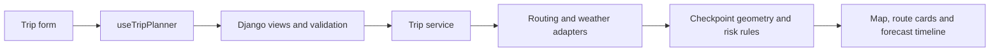

# Waycast · Weather-Aware Truck Routing

Waycast is a full-stack weather-aware truck route planner built for the Spotter AI developer assessment. It compares driving routes using forecast weather at the truck's estimated arrival times, explains load-sensitive risk, and provides a separate 48-hour corridor outlook.

**Application:** [weather-aware-truck-routing-app.onrender.com](https://weather-aware-truck-routing-app.onrender.com/) · **Repository:** [zumarzehgeer/weather-aware-truck-routing-app](https://github.com/zumarzehgeer/weather-aware-truck-routing-app)

[Run locally](#run-locally) · [Code tour](#architecture) · [Risk model](#weather-and-risk-model) · [API](#api) · [Tests](#verification) · [Deployment](#deployment-and-limitations)

**Deployment note:** The last recorded hosted check on **15 October 2026** encountered an upstream weather rate limit. Missing forecasts remain Unknown, and incomplete routes cannot be recommended. The labelled synthetic demo works independently of live providers. Subsequent local refactoring and successful local live checks do not establish that the hosted deployment is current or that its provider quota has reset. See the [validation record](docs/VALIDATION.md).

## Technology

| Area | Stack |
|---|---|
| Interface | React, TypeScript, Vite, Leaflet / React Leaflet, Lucide icons |
| API and external data | Django, HTTPX, OSRM, Open-Meteo geocoding and forecasts |
| Production | Gunicorn, WhiteNoise, Docker, Render configuration |
| Verification | pytest / pytest-django, Node test runner, Playwright Chromium |
| Code style | Black, Prettier, EditorConfig, LF line endings |

## Features

- City/town search with keyboard navigation, debouncing and cancellation of obsolete requests.
- Departure date, IANA timezone, truck load, and weather checkpoints every 10, 25 or 50 miles.
- Up to three distinct OSRM alternatives, with provider route-count disclosure.
- Arrival-time wind, rain and snow; risk miles, distance-weighted scores, and explained recommendations.
- Leaflet map with route selection, checkpoint popups, a checkpoint table, layer toggles and fit controls.
- A 49-frame hourly corridor forecast that can be explored without additional API requests.
- Responsive desktop/phone layouts, loading and validation messages, provider warnings, and stale-result labels.
- Explicit synthetic Chicago–Detroit demo; failed live requests never silently switch to demo data.

The navy/turquoise interface is inspired by [Spotter](https://spotter.ai/) and uses Waycast's own identity. Manrope is bundled locally through Fontsource; its [SIL Open Font License](frontend/public/assets/Manrope-OFL.txt) is included.

## Run locally

Requirements: **Python 3.12 or 3.13**, **Node 24**, and npm. CI and Docker use Python 3.12. No database setup, migrations, or API keys are needed for the default public providers.

Clone the repository, then run all commands below from its root:

```bash
git clone https://github.com/zumarzehgeer/weather-aware-truck-routing-app.git
cd weather-aware-truck-routing-app
```

### Windows · Git Bash

Install the dependencies once. `requirements-dev.txt` includes the application requirements and Python formatter:

```bash
python -m venv .venv
.venv/Scripts/python.exe -m pip install -r requirements-dev.txt
npm --prefix frontend ci
```

Open two terminals at the repository root:

```bash
# Terminal 1: Django API on port 8000
npm run backend
```

```bash
# Terminal 2: Vite frontend on port 5173
npm run frontend
```

Open **http://localhost:5173**. The API health endpoint is **http://127.0.0.1:8000/api/health**. Stop each server with **Ctrl+C**. Both reload source changes. No environment activation or root `npm install` is needed. The frontend refuses to start if port 5173 is occupied. In PowerShell, use `npm.cmd` instead of `npm` if execution policy blocks npm's script.

### Linux / macOS

```bash
bash scripts/setup.sh
.venv/bin/python -m pip install -r requirements-dev.txt
npm run backend
# In a second terminal:
npm run frontend
```

`setup.sh` installs dependencies, builds the frontend, collects static assets and checks Django. Alternatively, after setup, `bash scripts/dev.sh` starts both servers together. Vite proxies `/api` to Django on port 8000. The backend launcher selects the platform's virtual-environment Python and loads an optional root `.env`; `dev.sh` also loads `.env`. Django and the production container do not auto-load it.

Default local settings work without an `.env`. To customize them, run `cp .env.example .env` and edit the copy. Keep real secrets out of Git; production requires its own random secret.

### Try the demo

1. Select **Demo trip**. Chicago–Detroit endpoints are fixed and clearly labelled as synthetic.
2. Set departure roughly one hour ahead in the displayed timezone; start with **32,000 lb** and **25-mile** checkpoints.
3. Click **Compare demo routes** and read the route cards and recommendation explanation.
4. Select another route, click a checkpoint, or expand **Arrival-time checkpoints** to inspect the weather behind its score.
5. Move the forecast slider or toggle map layers. The corridor snapshot changes independently of arrival-time route scores.
6. Edit the load or another trip input. The stale-results notice preserves the last evaluated labels until you compare again.

For live data, choose **Live routes** and select both cities from search results. Typing an unresolved city name alone is insufficient. Actual routes and forecasts depend on provider availability.

## Architecture

```text
frontend/src/
  App.tsx             Page composition and risk-guide visibility
  hooks/              Trip inputs, request lifecycle and evaluated-result state
  components/         Trip form, search, comparison, forecast and checkpoint table
    map/              Leaflet viewport, route paths, forecast cells and checkpoint layers
  lib/                HTTP client with cancellation, deadlines and structured errors
  utils/              Time, duration and measurement formatting
  types.ts            API response types
  constants.ts        Demo cities, timezones and display colors
  styles/             Base, layout, form, map, results, guide and responsive styles
backend/config/       Django settings, URLs and WSGI
backend/routing/
  views.py            Thin HTTP endpoints and application rate limits
  validation.py       Trip input checks, timezone conversion and DST handling
  providers/
    common.py         Shared HTTP error mapping, cache keys and numeric validation
    geocoding.py      City/town search adapter
    routing.py        OSRM alternatives and validated edge timing
    weather.py        Batched forecasts, unit conversion, caching and quota budgets
  geometry.py         Edge-based checkpoint sampling, ETAs and corridor grid
  risk.py             Pure classification, aggregation and route ranking
  service.py          Trip orchestration and forecast assembly
  demo.py             Explicit synthetic fixtures
backend/routing/tests/  Backend regression tests
frontend/tests/         Map, planner, place-search and accessibility browser suites
frontend/tests-unit/    Request and formatting unit tests
scripts/                Setup, local startup, production startup and smoke checks
docs/                   Deployment instructions and validation summary
```

The React app and JSON API share an origin in production. Gunicorn and WhiteNoise serve the Django API and built frontend. No persistence or authentication is required. Production uses one Gunicorn worker with four threads so in-memory cache and quota controls are shared. Multiple workers/replicas require shared caching and distributed quota control.



### Suggested reading order

1. [App.tsx](frontend/src/App.tsx) composes the page; [useTripPlanner.ts](frontend/src/hooks/useTripPlanner.ts) owns editable inputs, submission guards, stale results and the last successful analysis.
2. [TripSidebar.tsx](frontend/src/components/TripSidebar.tsx) renders the form; [TripResults.tsx](frontend/src/components/TripResults.tsx) composes notices, the map, timeline, comparison and checkpoint table. Map layers are isolated under [components/map](frontend/src/components/map).
3. [views.py](backend/routing/views.py) receives the request and delegates input checks to [validation.py](backend/routing/validation.py).
4. [service.py](backend/routing/service.py) is the backend entry point for the planning pipeline: routes → checkpoint sampling → weather → risk summaries → recommendation and corridor frames.
5. [geometry.py](backend/routing/geometry.py) handles locations and timing; [risk.py](backend/routing/risk.py) contains the pure classification, aggregation and ranking rules. External calls live in [providers](backend/routing/providers).
6. [Backend regressions](backend/routing/tests) and [browser suites](frontend/tests) show boundary cases and end-to-end behavior. Shared test inputs live in backend `tests/factories.py` and browser `tests/fixtures.ts`.

Components render the interface, the hook coordinates client state, provider adapters handle external data, and the geometry/risk modules contain the domain calculations. Backend modules do not depend on frontend code. Synthetic data is isolated in `demo.py` and selected explicitly by the service.

## Weather and risk model

Checkpoints are interpolated along the provider's annotated edge distances and travel times. For each ETA, the backend selects the first hourly forecast boundary at or after arrival. Rain/snow represent the preceding hourly interval; wind is the sustained 10 m forecast at that boundary. There is no nearest-hour fallback beyond the returned series. Rain includes rain plus showers; units are normalized to mph and inches/hour. Missing or invalid values remain Unknown.

| Risk / score | Wind mph | Rain in/h | Snow in/h |
|---|---|---|---|
| Low / 0 | <25 | <0.10 | <0.5 |
| Moderate / 1 | 25 to <35 | 0.10 to <0.25 | 0.5 to <1.0 |
| High / 2 | 35 to <45 | 0.25 to <0.50 | 1.0 to <2.0 |
| Severe / 3 | 45 to <55 | 0.50 to 1.00 inclusive | 2.0 to 3.0 inclusive |
| No Travel / 4 | ≥55 | >1.00 | >3.0 |

Supplied load rules override wind classification:

- Load **>30,000 lb** and wind **45 to <55 mph**: No Travel.
- Load **>40,000 lb** and wind **35 to <45 mph**: Severe.
- Wind **≥55 mph**: No Travel at any load.

Each checkpoint takes the highest applicable risk. Each interval inherits the higher risk of its two endpoints. Miles are added by category; average risk is `Σ(interval miles × score) / total miles`. A missing endpoint makes an interval Unknown unless No Travel is already established. An incomplete route has no average score and cannot be recommended.

Eligible routes must have complete forecasts and no No Travel conditions. They are ranked by **Severe miles → High miles → distance-weighted average risk → duration**, using unrounded values. If none is eligible, no route is recommended.

### Corridor timeline versus arrival-time analysis

The colored corridor is a forecast grid, not radar. Representative cells cover the alternatives and their surroundings, with a maximum of 64 cells; longer corridors use coarser cells. Each uses center-point weather and the evaluated load.

The slider begins at the **next full UTC hour after evaluation** and includes 49 frames through +48h. Timestamps display in the evaluated trip's timezone. Scrubbing changes corridor colors only; route cards and checkpoint dots retain arrival-time risk. All frames arrive with the plan, so selecting routes, opening popups and moving the slider make no further provider requests.

## Providers and limits

| Purpose | Provider | Application behavior |
|---|---|---|
| Routing | [OSRM Route API](https://project-osrm.org/docs/v5.24.0/api/#route-service) | Full GeoJSON and edge distance/duration annotations; retains up to three unique paths. Fewer alternatives are disclosed. Cached 24h; outbound routing requests serialized to at most one/second. |
| City search | [Open-Meteo geocoding / GeoNames](https://open-meteo.com/en/docs/geocoding-api) | City/town results, not street addresses; six suggestions, 400 ms debounce, 24h cache. |
| Weather | [Open-Meteo](https://open-meteo.com/en/docs) | Seven UTC forecast days; 40 locations/batch, one outbound weather request at a time across the worker; 30-minute location cache. Short concurrency rejections receive bounded retries. Quota rejections trigger a cooldown and remain explicit. Missing forecasts are never treated as low risk. |
| Basemap | [OpenStreetMap standard tiles](https://operations.osmfoundation.org/policies/tiles/) | Visible attribution, normal browser caching and identifying referrer policy; no bulk download or offline prefetch. |

Application limits: 1,600 miles per alternative, 220 unique weather locations per plan, eight trip evaluations/minute/client, and 30 searches/minute/client. Location-based weather budgets are 500/minute, 4,500/hour and 9,000/day in the single worker. Batching does not make multiple locations one quota unit. Restarts, shared outbound IPs and provider accounting can still cause upstream limits. Per-client limiting uses `REMOTE_ADDR`, so a reverse proxy may conservatively share the limit across callers.

Default public routing/weather services have no availability guarantee; Open-Meteo's free endpoint is for non-commercial use. Follow each provider's current usage terms. Operational use requires appropriate provider access and truck-aware routing.

## API

- `GET /api/health` → liveness and `demo_enabled`; does not establish provider readiness.
- `GET /api/geocode?q=Chicago` → named places with latitude, longitude and timezone.
- `POST /api/plan` with JSON:

```json
{
  "origin": { "name": "Chicago", "latitude": 41.8781, "longitude": -87.6298 },
  "destination": { "name": "Detroit", "latitude": 42.3314, "longitude": -83.0458 },
  "departure_local": "2026-10-16T08:00",
  "timezone": "America/Chicago",
  "load_lb": 32000,
  "spacing_miles": 25,
  "demo": false
}
```

Replace the example departure with a future time within seven days. DST gaps and repeated local hours are rejected explicitly. Results display in the evaluated departure timezone, including destination arrival.

The response includes evaluated inputs, routes with geometry/checkpoints/summaries, nullable `recommended_id`, explanation, warnings, corridor timestamps/cell forecasts, provider disclosure and generation time. Geometry coordinates use **[longitude, latitude]**; Leaflet cell bounds use **[[south, west], [north, east]]**. Distances are miles, durations seconds and output timestamps UTC ISO-8601.

Errors use `{ "error": { "code": "...", "message": "..." } }`: 400 validation, 403 disabled demo, 415 content type, 422 trip/routing limits, 429 application limit, 502 provider failure and 503 provider throttling. Partial weather failures can return a plan with Unknown values and no recommendation for incomplete routes.

## Configuration

See [.env.example](.env.example). Keep real `.env` files and secret values out of version control.

| Variable | Purpose |
|---|---|
| `DJANGO_SECRET_KEY`, `DJANGO_REQUIRE_SECRET` | Production requires a random non-example key of at least 40 characters. |
| `DJANGO_DEBUG`, `DJANGO_ALLOWED_HOSTS` | Local debugging and permitted hostnames; Render's injected hostname is accepted automatically. |
| `ENABLE_DEMO` | Enable the explicit synthetic workflow; default true. |
| `OSRM_BASE_URL`, `WEATHER_BASE_URL`, `GEOCODING_BASE_URL` | Server-side provider endpoints. |
| `PROVIDER_USER_AGENT` | Project/contact identification for provider requests. |
| `TRUST_PROXY`, `SECURE_SSL_REDIRECT` | TLS proxy configuration; trust only a proxy that sanitizes forwarded protocol headers. |
| `PORT` | Production listener port; default 8000. |

## Verification

Last local verification after the structural refactor, **16 October 2026**:

| Check | Result |
|---|---|
| Backend regression tests | 120 passed |
| Frontend unit tests | 6 passed |
| Desktop / phone browser tests | 21 passed; one duplicate mobile layout check intentionally skipped |
| Production build, Django checks, static collection and formatting | Passed |
| Built-app synthetic smoke check | Passed |

These are local results, not a claim of hosted live-provider availability. Full context is in [docs/VALIDATION.md](docs/VALIDATION.md).

### Run the suites

From the repository root in Windows Git Bash:

```bash
.venv/Scripts/python.exe -m pytest -q
npm --prefix frontend run test:unit
npm --prefix frontend run build
.venv/Scripts/python.exe backend/manage.py check
(cd frontend && npx playwright install chromium)
npm --prefix frontend run test:e2e
```

On Linux/macOS, substitute `.venv/bin/python` for `.venv/Scripts/python.exe`. Install the browser from the frontend directory with `npx playwright install --with-deps chromium` if system dependencies are needed. The default browser suite collects built assets and starts its own Django server on port 8000; stop an existing server first.

To test servers that are already running instead:

```bash
PLAYWRIGHT_BASE_URL=http://127.0.0.1:5173 npm --prefix frontend run test:e2e
```

Browser tests use the real Django synthetic-demo endpoint and explicit failure fixtures, and suppress basemap requests. They do not consume live weather quotas or establish live provider readiness. Backend tests cover risk boundaries, geometry/timing, input validation, provider responses, caches and concurrency. Frontend unit tests cover request cancellation/deadlines and formatting. CI runs setup, tests and the production build. See the [validation summary](docs/VALIDATION.md).

### Code style

Python uses Black; TypeScript, JSX, CSS and frontend configuration use Prettier. Editor defaults are in `.editorconfig`, and Git preserves LF line endings. The setup steps above install both formatters. If you installed only runtime dependencies, install `requirements-dev.txt` before running Black.

Check formatting from the repository root:

```bash
.venv/Scripts/python.exe -m black --check backend scripts
npm --prefix frontend run format:check
```

To apply formatting, omit Black's `--check` and use `npm --prefix frontend run format`. On Linux/macOS, use `.venv/bin/python`. CI runs both formatting checks alongside the regression suites. Formatter dependencies are for development; the Docker runtime installs `requirements.txt` only.

### Smoke checks

Check a running deployment separately from the regression suites:

```bash
.venv/Scripts/python.exe scripts/smoke.py --base-url https://YOUR-HOST
# Optional real-provider check; consumes provider quota:
.venv/Scripts/python.exe scripts/smoke.py --base-url https://YOUR-HOST --live
```

Replace `https://YOUR-HOST` with the actual deployment URL or a local Django server serving the built frontend. The default checks health, frontend assets and synthetic planning. `--live` additionally exercises real providers and fails when arrival forecasts are incomplete. See [deployment instructions](docs/DEPLOYMENT.md) for building and serving the production app.

### Common setup issues

| Symptom | What to check |
|---|---|
| Backend reports a missing Python environment | Create `.venv` in the repository root and install the requirements for your platform. |
| Port 5173 or 8000 is occupied | Stop the older development server. Browser tests can reuse running servers with `PLAYWRIGHT_BASE_URL`. |
| Django reports that the frontend is not built | Use Vite on port 5173 for development, or build the frontend and collect static files before serving it through Django. |
| Live weather is Unknown or rate-limited | Read the provider warning and pause requests after throttling. Demo trip remains an explicitly synthetic alternative. |
| A typed city cannot be submitted | Select a city from its search suggestions so the trip has coordinates. |

## Deployment and limitations

See [Docker and Render deployment instructions](docs/DEPLOYMENT.md). The multi-stage Docker image builds the frontend, collects static assets and runs as a non-root user. `render.yaml` defines a single Docker web service; a separate frontend host, database or persistent disk is unnecessary.

OSRM's driving profile does **not** enforce commercial truck height, weight, hazmat or road restrictions. Load affects the weather model only. ETAs exclude live traffic, stops and rest breaks. Forecast grids, hourly values and checkpoint sampling are approximations; gusts, ice, visibility, terrain exposure and flooding are not modeled. A recommendation under this supplied model does not establish driving safety. In-memory budgets reset on restart and are not distributed abuse protection.
